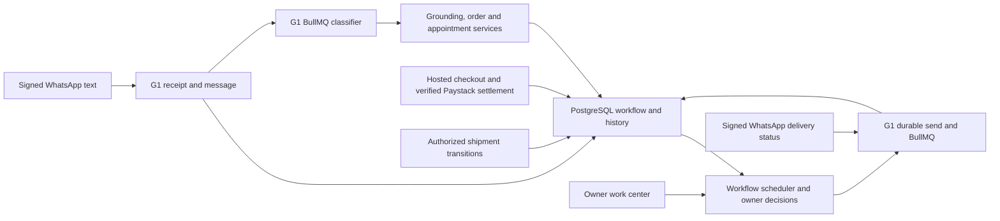

# Batch 2 platform contract

## Boundaries

The Fastify API and existing workers remain one deployable system. PostgreSQL owns workflow and commercial state. BullMQ still runs the G1 classifier and outbound workers. The workflow scheduler scans due rows in PostgreSQL, so losing a workflow wake-up in Redis is outside this path. Redis recovery for actual queue work remains with the G1 receipt and outbound schedulers.

## State, versions and transaction contracts

The `workflow_settings` row records owner enablement, a preset and the status reply policy. The `workflows` row persists tenant, customer, stable receipt correlation, original source, optional explicit purchase reply, definition and policy revisions, operator, wait deadline and linked business records. The `workflow_evidence` stream gives every transition a unique scoped event key. The `workflow_approvals` row binds one verified status send to its order, version, policy revision, approved facts and deadline. Workflow rows reference the customer's compound tenant identity. Evidence and approvals reference the workflow's compound tenant identity. Domain links are resolved using the tenant, customer and source, or with the tenant and existing shipment relationship.

Text materialization commits workflow admission alongside the linked message and receipt. Polling batches at most 12 short transactions. Each transaction claims one due row with `FOR UPDATE SKIP LOCKED` and commits state and history together. If the process exits, PostgreSQL rolls the uncommitted transition back and another scheduler can claim it. Scheduler failures never mean an external effect succeeded. Status send authorization creates the G1 outbox row, decision execution record and workflow handoff in the same transaction. G1 outbound revalidates policy, scoped facts and send identity at the claim before provider I/O. Recovery uses the outbox's current state and never creates a second provider send for an ambiguous first attempt.

The server deployment setting `WORKFLOW_DEFINITION_VERSION=1|2` selects the version for new admissions. The default is 1. Both versions use the same transitions. Version 1 allows 24 hours to approve a reply. Version 2 allows 12. Each workflow reads its pinned version. A policy revision change moves existing eligible work to review and fences future commands under the prior policy. Enablement, commercial domain settings, and template versions are distinct, with business facts rechecked by G1 at each commercial mutation.

| Category | Meaning |
| --- | --- |
| Created, ready, running | Accepted, ready to advance, or waiting for G1 inbound processing. |
| Waiting customer | A grounded quote was offered or more customer details are needed. An explicit purchase reply quoting the actual provider message may continue its quote workflow. Unthreaded messages are separate work items. |
| Waiting owner approval | The attached, verified order update requires the active tenant owner. |
| Waiting staff | The G1 order or shipment requires a staff transition. Existing authorization and assignments apply. |
| Waiting provider | A hosted payment still needs verified settlement, or an outbound send needs signed delivery evidence. |
| Retry scheduled | The owner requested a bounded reconciliation of recorded effects. It cannot initialize another checkout or resend a message. |
| Review required | There is unavailable or ambiguous evidence, a changed policy, an expired dependency, or an unsupported outcome. |
| Completed | Verified notification evidence was recorded. |
| Failed, cancelled | An owner declined or cancelled an eligible pending action, or the existing domain record was cancelled. Existing committed commercial effects use their existing correction paths. |

## Operator transitions and connectors

| Operator | Authoritative input, authorized action and handoff |
| --- | --- |
| Sales & Orders | G1 evidence-gated quote and source-bound order. An explicit customer reply may bind one purchase to the provider message carrying the quote. Existing order service controls current prices, stock and confirmation. |
| Leads & Bookings | G1 service, opening hours and capacity. An explicit, grounded booking request reserves a slot. Existing diary authorization and the PostgreSQL capacity constraint apply. A signed delivery callback verifies the booking confirmation. Deposits and reminders are outside the current implementation. |
| Payments & Invoices | G1 authenticated hosted checkout and signed, independently verified Paystack settlement. Batch 2 links those records. The existing payment service remains responsible for creation. The scheduler does not create financial effects on replay. |
| Fulfillment & Operations | G1 order, assigned shipment and fulfillment-task evidence. Verified payment precedes the workflow handoff. G1 shipment routes and services enforce tenant and assignment permissions. Existing staff transitions drive dispatch and delivery. |
| Customer Care & Retention | Scoped order status and verified gateway payment status. Missing facts create an owner-visible review item. Status reply content comes from current domain records. The support reply and fulfillment notice complete on signed delivery evidence. |

WhatsApp uses the G1 signature, historical phone ownership, replay limits and provider evidence. Paystack uses the existing signature, request identity, merchant binding, ledger and amount reconciliation. Order and shipment events use scoped, committed database records, with repeated or out-of-order observations checked against the current workflow and business state. Approval decisions use the owner access token and optimistic workflow revision. Raw triggers, unsigned requests, browser-supplied action payloads and model prose cannot create a workflow effect. Existing rate limits protect Fastify, and bounded database scanning and existing G1 scheduling control background work.

A future connector must supply a verified source account, tenant and immutable event identity, validated payload, capability boundary, delivery and reconciliation evidence, and a documented retry and connection lifecycle. Email and website connectors are unimplemented.

## Setup and owner API

On the dashboard, the owner chooses Online retailer, Custom orders, Appointment business or Professional services. The server validates these choices and recommends commerce or appointment plus support. The owner can disable admission, require owner review for verified replies, or allow routine verified replies. Products, prices, hours, staff, delivery, service capacity, WhatsApp and payments reuse the G1 setup surfaces and services. The preset does not enable automation beyond what those services authorize.

- `GET /api/v1/workflows?state=WAITING_OWNER_APPROVAL` gives up to 50 tenant workflows. `before` accepts an ISO timestamp.
- `GET /api/v1/workflows/<id>` returns owner controls, approval and up to 100 history entries.
- `GET /api/v1/workflow-settings` returns settings and preset recommendations.
- `PUT /api/v1/workflow-settings` accepts `{"profile":"ONLINE_RETAIL","enabled":true,"supportMode":"OWNER_REVIEW","revision":0}`. Use revision zero to create and the current revision to edit.
- `POST /api/v1/workflows/<id>/decision` accepts `{"approve":true,"revision":2}`.
- `POST /api/v1/workflows/<id>/cancel` and `POST /api/v1/workflows/<id>/retry` accept `{"revision":2}` only while eligible.

The work center shows recent work with status filters, history, approval, decline, cancellation and safe reconciliation. It polls and uses the existing authenticated API client. Owners hold these controls today. Staff still use their existing domain surfaces. Amount attribution is unknown without billing data. Verified quote and booking evidence includes model token counts when the provider supplied them locally.

## Recovery and schema rollback

Inspect the tenant's work-center history. For send ambiguity, use the existing send record and authenticated callback evidence. For payment ambiguity, use the G1 settlement and initialization records. Capture the workflow correlation ID and business resource IDs for escalation. A safe retry checks already recorded effects. It does not authorize a new send, payment, order or appointment. Use the established business-domain cancellation or reversal where an effect already committed.

Apply the additive migration before starting upgraded workers. For application rollback, quiesce admissions and worker traffic, back up PostgreSQL, stop the Batch 2 binary, and run the G1 binary with the additive tables intact. Preserve the workflow evidence. Before re-enabling Batch 2, reconcile affected G1 provider intents and workflow rows. A schema removal would discard workflow records and is not the normal recovery.
