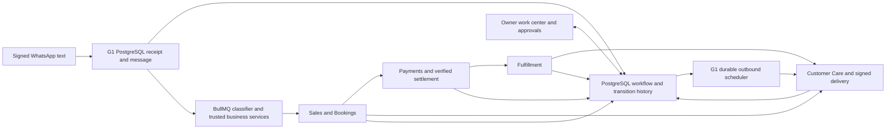

# Batch 2 engineering report

**Recommendation — PASS for the verified local Batch 2 scope.** The final source passed the full regression and a fresh repeat. Live-provider and hosted assurance remain unverified.

## Source and implementation

The implementation is on `codex/batch-2-execution-platform` at `c4d702666902229327c2db25651db80b803efe82`. The branch starts at approved G1 evidence commit `fe411b5541127d172c352e47fa6c67521f2ee3b8`, whose verified runtime was `84c92ac0c5c70bad0b6c9d28e7ea15688ef33d4d`. The local release snapshot matched the final runtime and test sources. The unrelated launch checkout was preserved.



The [platform contract](contract.md) describes the engine and every supported operator trigger, handoff, permission, recovery path and connector. The [ADR](../adr/0008-shared-workflow-execution.md) explains persistence and transaction ownership. The [progress register](progress.md) records checkpoints. The batch keeps the existing Fastify, PostgreSQL, Prisma, Redis/BullMQ and React services. Workflow settings offer four validated business presets. The owner work center provides scoped history, approvals, rejection, safe retry, cancellation and escalation.

Migration `20261115120000_shared_workflow_execution` adds four tables and two enums. Receipt materialization commits workflow admission with the message link. PostgreSQL protects each state and evidence transition with a due-row lock. Status approval execution records the scoped outbox intent and approval evidence together. The outbound claim rechecks the current policy, order or payment facts, tenant, customer and original WhatsApp phone ownership. Commercial writes continue through the G1 order, booking, settlement and shipment services.

## Acceptance matrix

| Journey | Final local evidence |
| --- | --- |
| 1. Retail | Passed twice. The real signed WhatsApp path delivered a grounded quote. An explicit customer reply continued that workflow and produced one order. An explicit checkout request used the G1 payment service and synthetic hosted provider. Duplicate Paystack callbacks yielded one independently verified settlement. Authorized dispatch and completion led to one fulfillment history transition and signed customer delivery. The workflow completed. |
| 2. Appointment | Passed twice. The real service used configured opening hours, current availability and the PostgreSQL reservation. Replayed input and another customer's request for the same slot produced one appointment. Signed delivery completed the booking confirmation. A manager retained diary access, the owner could cancel, rider reads and writes were refused, and a foreign owner received 404 on cancellation. |
| 3. Customer support | Passed twice. Scoped order and verified payment lookups produced a constrained reply. An unknown reference produced an owner-visible review without a notification. |
| 4. Human approval | Passed twice. Two simultaneous owner decisions yielded one success and one conflict and authorized one reply. A foreign tenant was refused. Changed order facts and policy revisions prevented execution. Real Chromium also exercised owner login, evidence inspection and approval persistence. |
| 5. Failure recovery | Passed in the full run and the independent repeat. A killed workflow process lost its uncommitted write after PostgreSQL released the lock. Competing schedulers produced one transition. Retrying an ambiguous outbound attempt kept the original send and attempt count. The full G1 regression also exercised real Redis restart, evicted queue jobs, database saturation, uncertain provider acceptance, and process interruption before and after business effects. |
| 6. Version and cancellation | Passed twice. A version 1 approval remained pinned as version 2 began admitting work. Owner cancellation blocked a late decision. A signed late callback with no committed send for the cancelled workflow left it terminal. |
| 7. Tenant and staff security | Passed twice. Foreign workflow IDs and decisions were refused. Delivery-only staff could neither inspect owner workflows nor access the diary. Reassignment of the source phone invalidated the queued reply before provider I/O. The G1 tests exercised signed ingress, tenant collisions, settlement isolation and shipment assignment. |

## Verification results

All final commands here ran against the implementation at `c4d7026`, except the G1 binary rollback smoke. Windows uses `pnpm.cmd`. All app verification used disposable IPv4 loopback PostgreSQL and Redis with synthetic tenants, signing keys and provider responses.

| Command or gate | Exit | Evidence |
| --- | --- | --- |
| `pnpm install --frozen-lockfile` and `pnpm db:generate` | 0 | Frozen dependencies installed in a short-path checkout. Prisma 5.22 generated using the local installed engine binaries. |
| `pnpm build`, `pnpm typecheck`, `pnpm lint`, `pnpm test` | 0 each | API 991 passed and 172 fixture-only skips. Web 3 passed. |
| Full PostgreSQL and BullMQ regression | 0 for each Vitest command | 31 assistant-authority tests and 386 other tests across 29 files. 417 total, zero failures or skips. |
| Fresh Batch 2 repeat | 0 | 43 passed across both files. Zero failures or skips. |
| `pnpm db:migrate` and `pnpm exec prisma migrate status --schema prisma/schema.prisma` | 0 on both final fixture runs | All 34 migrations applied on empty and seeded historical upgrade databases. G1 receipt and payment records survived the historical restore control. |
| `pnpm smoke:fixture` on Batch 2 | 0 | 53 passed, zero failures. Compiled API startup, SPA deep link, JSON API 404 and graceful shutdown were exercised. |
| `node apps/api/tests/fixtures/batch-workflow-browser.mjs` | 0 | Real mobile Chromium, real owner login and Fastify, visible scoped history, persisted approval. |
| `pg_dump --format=custom`, `pg_restore --exit-on-error`, and `psql -v ON_ERROR_STOP=1` verification | 0 each | A separate database contained the restored stored approval and its transition evidence. |
| Approved G1 binary running `pnpm smoke:fixture` against the Batch 2 migrated schema | 0 | 53 passed, zero failures. The rollback left the additive tables in place. |

The full regression took 78 seconds for the separate assistant command and 354 seconds for the remaining files. The fresh repeat took 176 seconds. The combined signed operator case took 103 and 100 seconds on the two runs, including three G1 retail controls, real worker scheduling and fixture delays. This was a correctness campaign. It does not constitute sustained load or latency certification. Workflow quote and booking evidence carries locally available model token counts. Monetary cost remains unknown without billing evidence.

### Diagnosed failures before the final runs

- The long-path Windows fixture migrated successfully but Vitest could not connect to PostgreSQL and returned Prisma P1001. PostgreSQL stayed running and reported aborted client sockets. The underlying connection failure was unproven. The short-path runs connected successfully. Fresh Prisma generation initially hit a TLS reset and succeeded using installed local binaries.
- An early short-path run passed 36 of 37 cases. The journey used an appointment fixture without opening hours and could not find a slot. The fixture now seeds a real schedule.
- The first full regression returned exit 1 with 416 passes and one failure. The independent repeat returned exit 1 with 41 passes and two failures. The journey reproduced a G1 diary authorization defect. A delivery account's shipment capability reached tenant diary cancellation. The [defect register](../g0/defects.md) documents the tightened diary boundary. The remaining repeat failure came from a one-second assertion on recovery immediately after child exit. The corrected fixture waits for proof that PostgreSQL released the specific row lock before racing schedulers. Both final runs passed.
- Another recovery probe failed before checking the lock because Node IPC returned its payload plus an undefined handle. The test now checks the payload and continues through lock release, rollback and recovery.
- An earlier compiled smoke attempt returned exit 1 after a Redis connection timeout and before API health. Its root cause was unproven. The serial fixture returned PONG and both compiled binaries subsequently passed. Initial Chromium selection returned exit 1 because that Playwright cache lacked its default browser binary. The installed Chromium executable passed. A supplemental inline Redis check returned exit 1 after Windows command quoting removed the module-name quotes. The same PING from a file returned exit 0.

## Reproduction

Use a clean, short checkout with Node 20, pnpm 9, PostgreSQL 17 and disposable Redis or Memurai. Bind dependencies to IPv4 loopback. Set synthetic provider credentials and enable the fixture network guard. The full regression uses the historical seeds and commands in the [G1 full suite](../g1/batch-1-report.md#reproduction), with `tests/workflow-execution.integration.test.ts` added to the second Vitest command. Use the specified regression variables and add `G1_BATCH_DATABASE_URL` and `G1_BATCH_REDIS_URL` for the workflow suite. The signed journeys additionally need `G1_03_TEST_DATABASE_URL`, `G1_03_TEST_REDIS_URL` and `G1_03_UPGRADE_DATABASE_URL`.

```sh
pnpm install --frozen-lockfile
pnpm db:generate
pnpm build
pnpm typecheck
pnpm lint
pnpm test
pnpm db:migrate
pnpm exec prisma migrate status --schema prisma/schema.prisma
pnpm --filter @flowdesk/api exec vitest run tests/assistant-policy.integration.test.ts --maxWorkers=1 --minWorkers=1 --testTimeout=30000 --reporter=verbose
pnpm --filter @flowdesk/api exec vitest run tests/workflow-execution.integration.test.ts tests/paystack-settlement.integration.test.ts --maxWorkers=1 --minWorkers=1 --testTimeout=30000 --reporter=verbose
pnpm smoke:fixture
node apps/api/tests/fixtures/batch-workflow-browser.mjs
pg_dump -h 127.0.0.1 -p "$pg_port" -U flowdesk_g1 -d flowdesk_g1_empty --format=custom --file="$dump"
pg_restore --exit-on-error -h 127.0.0.1 -p "$pg_port" -U flowdesk_g1 -d flowdesk_g1_upgrade "$dump"
```

Use new fixtures for the repeat. Set `B2_PLAYWRIGHT` to an absolute local Playwright ESM entry and `B2_CHROMIUM` to an installed Chromium binary for the browser check. After the restore, run the following query with `psql -X -v ON_ERROR_STOP=1` against the restore database. The fixture returned one row count.

```sql
SELECT count(*)
FROM workflow_approvals a
JOIN workflow_evidence e
  ON a."workflowId" = e."workflowId" AND a."businessId" = e."businessId"
WHERE a.decision = 'APPROVED' AND e."eventType" = 'APPROVAL_APPROVED';
```

Quiesce Batch 2 and run the approved compiled G1 binary against the migrated database for the application rollback rehearsal. The old binary used the same loopback database and Redis with synthetic transactions only. Preserve the additive tables and reconcile committed provider intents before re-enabling Batch 2.

## Security, financial correctness and limits

The supported scope uses tenant and customer checks, existing eligibility and pricing rules, committed fulfillment evidence, and independently verified gateway settlement. A retry reconciles existing action identity and cannot authorize another external action. Provider ambiguity stays in review until reconciled. No P0 tenant, correctness or financial fault remained in the exercised local scope. The added-source credential format scan returned zero matches. The test checkout contained zero application dotenv files.

Owner approvals cover a verified status reply. Existing business services continue to own stock, order, diary, payout and shipment decisions. Ambiguous checkout initialization goes to G1 reconciliation. Unthreaded follow-ups start separate work items. Appointment deposits, reminders, generic financial or discount approvals and additional connector implementations remain future work. Live-provider credentials, provider billing and hosted deployment were outside this local verification. No production access, deployment or merge occurred.
