# Batch 3 commerce contract

The [completion contract](closure-contract.md) documents standalone allocation, reminder recovery, partial returns and browser checkout recovery added after the original verified revision.

## Composition and workflow versions

The existing Fastify API and PostgreSQL/BullMQ runtime owns all commerce work. The G1 receipt dispatcher admits authenticated WhatsApp text, and it links the admitted workflow and message in one transaction. A retail or custom-order profile with commerce enabled admits workflow definition version 3. Earlier definitions retain their established transitions.

```mermaid
flowchart LR
  A[Signed WhatsApp inquiry] --> B[Version 3 workflow]
  B --> Q[Itemized quote and temporary stock hold]
  Q --> O[Explicit acceptance and existing order]
  O --> I[Itemized invoice]
  I --> P[G1 checkout and verified ledger credit]
  P --> F[Preparation and authorized physical fulfillment]
  F --> N[G1 outbound and signed delivery evidence]
  N --> C[Completion and supported care]
  C --> R[Complaint or return case]
```

## Sales and stock

Owner configuration enables pickup or delivery. Each variant is an independently tracked catalogue SKU with a tenant-scoped parent product. Available stock is current stock less offered, unexpired quote quantities. The commerce code acquires sorted product and parent locks before checking availability. A custom or service item does not move physical stock. Existing product images, stock movements and threshold notifications are reused.

A supported signed request uses `QUOTE RICE-BLUE*2, BAG*1 PICKUP` or `QUOTE RICE-BLUE*2 DELIVERY: Street, city`. A made-to-order request appends `| SPEC: supplied details`. The SKU and quantity are explicit. The server resolves the actual products, applies the best active catalogue promotion or quantity tier, and respects the configured price floor. The snapshot uses Decimal arithmetic at GHS two-decimal precision. No model text grants a discount or creates a price.

A custom quote starts as a draft until the owner approves the terms. A normal offer holds stock until its configured expiry. A terminal rejection or expired draft leaves no reservation. The scheduler persists expiry, and stock checks stop counting expired offers by timestamp even before that pass runs. The customer accepts using `ACCEPT <quote UUID>` or rejects using `DECLINE <quote UUID>`. Acceptance requires the same tenant and customer, current signed inbound phone ownership, original offered terms, current catalogue eligibility, an open reservation and unchanged policy. A changed price requires a new quote. Before acceptance, changing terms is done by replacing the declined or expired quote. Accepted order terms are fixed.

The acceptance transaction marks the quote, records the existing order and its exact lines, consumes held stock through the existing movement service, records confirmation, issues the invoice and links the customer message. Replays return the accepted order. A failed transaction rolls back all those changes. Before dispatch, authorized cancellation restores stock once and cancels pending links. An owner can confirm full physical return of a fulfilled order that contains only tracked goods. Stock restoration and return history commit together, and the case stays waiting for any remaining customer or financial outcome.

## Payments and invoices

An accepted quote issues one immutable GHS commercial invoice for its order. The invoice contains SKU, quantity, list and agreed prices, subtotals, total, due date and any configured deposit. The customer-readable version uses the existing durable WhatsApp send. The dashboard displays the same itemized snapshot.

The invoice balance is derived from non-voided, attested G1 ledger records. Claims do not change it. Verified payment additionally requires independent Paystack settlement evidence. The first charge is the configured deposit or full due amount. After a partial payment, the next eligible link is the remaining amount. The invoice guard runs in both G1 initialization transactions under the relationship lock and blocks a changed amount or a competing live or ambiguous link. A callback for a cancelled order or amount larger than the new balance is retained for reconciliation.

The supported invoice is an operational GHS invoice. It does not add jurisdiction-specific tax, mandated document certification, or settlement into a bank account. Ambiguous, reversed, disputed and late provider effects follow the G1 reconciliation contract. The engine does not move external funds automatically.

## Fulfillment

The workflow creates one prep or production task after verified ledger evidence reaches the configured release threshold. Release locks the same order row as cancellation and rechecks the current status. The default is payment in full. Release on a verified deposit requires explicit enablement and a configured deposit. The invoice continues to show its actual outstanding amount.

The existing order surface starts preparation. A permitted owner or staff member records that packing or production is ready. Delivery staff retain assignment-scoped shipment permissions. Dispatch requires acknowledged readiness, eligible payment and a delivery order. Pickup requires staff collection confirmation. Cancellation before handoff terminates preparation. Delivery and pickup evidence are separate from customer notification, whose verified completion depends on signed outbound status.

## Care and consent

Supported status questions use G1 and Batch 2 scoped business evidence. Complaints, cancellations, returns and exchanges create one case per signed source. A customer-provided order reference is linked only when the same customer and tenant own the order. The initial response identifies the case and explains how the customer can confirm that it was resolved. It promises neither a refund nor an outcome.

Cases can be open, assigned, waiting, escalated or resolved. Staff writes require a current capability and assignment when applicable. Optimistic revisions and locked updates prevent duplicate decisions. Case history holds the actor, revision and evidence that supports closure. Resolution requires an already cancelled order for a cancellation case, or the same customer's signed `RESOLVED <case UUID>` message. A return request alone does not restock a product or create a refund.

The owner may authorize one service follow-up per fulfilled order. This requires business enablement, a current conversation window, explicit customer consent and no block. `START ORDER FOLLOWUPS` opts in. `STOP ORDER FOLLOWUPS` clears consent at signed receipt admission. The worker verifies consent again before claiming the send. This sends a service check about an existing order.

## Access and abuse controls

| Attempt | Authority |
| --- | --- |
| Supply an arbitrary foreign quote, order, product or case identifier | Scoped service lookups, composite foreign keys and signed message scope enforce tenant and customer identity. |
| Claim a discount, available stock, bank transfer or fulfillment in a message | Catalogue and stock locks, the G1 ledger and verified settlement, and physical order evidence each govern their own transition. |
| Use a saved staff token after permission or assignment changes | Staff capabilities are re-read on relevant writes, and existing G1 shipment actions retain assignment checks under transaction locks. |
| Replay an accepted quote, provider callback, shipped order update or physical return | The quote, receipt, ledger entry, preparation, case history and stock claim have durable identities at their respective mutation boundaries. |
| Send a follow-up after consent changes | Signed opt-out takes effect at admission. The worker checks current consent, business enablement and delivery eligibility at claim. |

Preserve G1 authenticated media access and redaction. The commerce case keeps references to its evidence. Do not paste customer contact information or message text into a recovery ticket. Use workflow, receipt and record IDs for investigation.

## API and owner controls

The dashboard Commerce section provides settings, custom quote decisions and customer cases. The existing Products form saves SKU and variant information. The order drawer presents the invoice, remaining balance, checkout request, preparation and eligible follow-up. Orders and shipment actions continue using their existing controls.

- `GET/PUT /api/v1/commerce/policy` reads or saves owner-scoped fulfillment and payment settings with a revision.
- `GET/POST /api/v1/commerce/quotes` lists or issues scoped quotes. A request key replays the same normalized terms.
- `POST /api/v1/commerce/quotes/:id/decision` accepts `{"decision":"OFFER"}` or `{"decision":"DECLINE"}` from the owner.
- `GET /api/v1/commerce/invoices?orderId=<id>` and `GET /api/v1/commerce/invoices/:id` identify and inspect the payable record.
- `POST /api/v1/commerce/invoices/:id/checkout` accepts `{"send":true}` and calculates the payable charge server-side.
- `PATCH /api/v1/commerce/orders/:id/preparation` accepts `{"state":"READY","assignedStaffId":null}` for eligible work.
- `GET /api/v1/commerce/cases`, `GET /api/v1/commerce/cases/:id` and `PATCH /api/v1/commerce/cases/:id` serve the scoped case and its revisioned decision.
- `POST /api/v1/commerce/cases/:id/receive-return` accepts `{"revision":0}` from the owner who verified receipt of the full tracked order. It retains the original ledger transaction history.
- `POST /api/v1/commerce/orders/:id/followup` authorizes the single eligible service check.

## Recovery and deployment boundary

Correlate the receipt and workflow source with quote ID, accepted order, invoice, G1 request and settlement, prep record, and send identifiers. Use existing receipt, settlement and outbound history to distinguish waiting and ambiguity. The engine only releases physical work from committed financial evidence. Retry an ambiguous checkout through the G1 reconciliation process before issuing a different link. Run the supported order or case action rather than editing raw workflow state.

1. If an offer expires, inspect the quote timestamp, confirm stock held by unexpired offers, and issue a replacement quote if the customer still wants the items.
2. If a customer reports a payment while the invoice is waiting, reconcile the existing provider reference and ledger entry. Revisit preparation eligibility only after durable authoritative evidence appears.
3. If preparation or dispatch is blocked, check current order status, assigned staff, verified threshold and physical readiness. Record the facts in the existing order or case before resuming.
4. If the shipment completed but its notification remains waiting, use G1 outbound evidence and recovery. Leave the physical fulfillment record in place.
5. If full tracked goods were returned, the owner may record actual custody once. Keep the case waiting when a financial or customer outcome still needs evidence. Use the existing authorized ledger adjustment path for a refund that was actually performed.

The migration adds commerce tables, references, policy checks and customer/product flags. Deploy schema before binaries. The application rollback uses the approved Batch 2 binary with the additive database in place and the ingress and workers quiesced. Preserve accepted quotes, invoices, consent and cases during reversal. Any schema rollback that would discard these records requires a separate data migration and approval.
