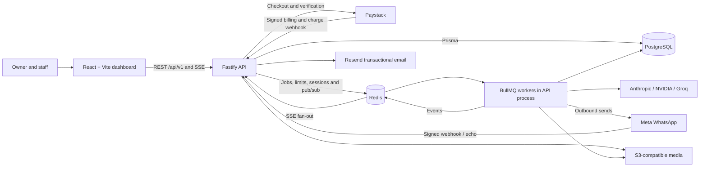

# G0 current-state architecture

Audited source `541b7b85da7755d84374bb9d483a69b3f49fdf77`. Deployment entries describe checked-in configuration. Hosted routing and live integrations are unverified.

## Code inventory

| Surface                        | Paths and responsibility                                                                                                                                                                                                                                                                                                                                                                                                                                                                                                                                                                                                                                                               |
| ------------------------------ | -------------------------------------------------------------------------------------------------------------------------------------------------------------------------------------------------------------------------------------------------------------------------------------------------------------------------------------------------------------------------------------------------------------------------------------------------------------------------------------------------------------------------------------------------------------------------------------------------------------------------------------------------------------------------------------- |
| Web entry and navigation       | [App.tsx](../../apps/web/src/App.tsx) and [Layout](../../apps/web/src/components/shared/Layout.tsx) mount one SPA. Public landing, legal and account routes lead to dashboard, orders, messages, bookings, products, customers, payments, reports, staff and settings. [api.ts](../../apps/web/src/lib/api.ts) handles access/refresh and response envelopes. React Query hooks and [useSSE](../../apps/web/src/hooks/useSSE.ts) update views.                                                                                                                                                                                                                                         |
| API bootstrap and perimeter    | [app.ts](../../apps/api/src/app.ts) mounts versioned REST, raw webhook body opt-in, health, CORS, rate limits and error envelopes. [server.ts](../../apps/api/src/server.ts) opens DB and Redis, starts workers and SSE fan-out, schedules insights and drains on shutdown.                                                                                                                                                                                                                                                                                                                                                                                                            |
| Identity and tenancy           | [auth](../../apps/api/src/modules/auth), [staff](../../apps/api/src/modules/staff) and [middleware](../../apps/api/src/middleware) implement owner and staff sessions, OTP, revocation, tenant context, role gates and assignment scope. The [shared role matrix](../../packages/shared/src/roles.ts) distinguishes manager, operations and delivery.                                                                                                                                                                                                                                                                                                                                  |
| Commercial REST                | [orders](../../apps/api/src/modules/orders), [products](../../apps/api/src/modules/products), [payments](../../apps/api/src/modules/payments), [bookings](../../apps/api/src/modules/bookings) and [shipments](../../apps/api/src/modules/shipments) own mutations and validation. [billing](../../apps/api/src/modules/billing) manages FlowDesk subscriptions separately from merchants' receipts.                                                                                                                                                                                                                                                                                   |
| Owner workflow REST            | [messages](../../apps/api/src/modules/messages), [customers](../../apps/api/src/modules/customers), [dashboard](../../apps/api/src/modules/dashboard), [settings](../../apps/api/src/modules/settings), [sse](../../apps/api/src/modules/sse) and [whatsapp](../../apps/api/src/modules/whatsapp) provide inbox, segmentation, reports, business profile, activity updates and Embedded Signup.                                                                                                                                                                                                                                                                                        |
| Inbound pipeline               | [Meta route](../../apps/api/src/modules/webhook/webhook.route.ts) validates raw HMAC and parses supported messages and app echoes. [Message worker](../../apps/api/src/workers/message-processor.worker.ts) maps phone-number ID to business, upserts message and customer, handles image and payment-claim signals, then queues intent classification.                                                                                                                                                                                                                                                                                                                                |
| Decision and outbound pipeline | [Intent worker](../../apps/api/src/workers/intent-classifier.worker.ts) runs rules and assistant paths. [Assistant](../../apps/api/src/services/assistant) builds evidence, parses model decisions and routes to drafts, clarification, booking, order/delivery or human review. [Notifications](../../apps/api/src/services/notifications) evaluate delivery policy and templates. [Outbound worker](../../apps/api/src/workers/outbound.worker.ts) sends and records Meta message IDs. [Dead letter worker](../../apps/api/src/workers/dead-letter.worker.ts) retains failures. [Insights worker](../../apps/api/src/workers/insights.worker.ts) produces scheduled daily summaries. |
| Shared contracts               | [packages/shared/src](../../packages/shared/src) contains roles, auth, intent, assistant, profile, payment confidence and SSE contracts consumed by web and API.                                                                                                                                                                                                                                                                                                                                                                                                                                                                                                                       |

Order list example. A query hook calls `GET /api/v1/orders` through the web client. Fastify authenticates the bearer token, resolves the tenant, checks `orders.read`, parses Zod filters and applies delivery assignment scope. The repository queries Prisma with the tenant, filters and pagination. Changes emitted over SSE invalidate relevant query keys. Shipment routes and order stats have scope gaps documented in the [defect register](defects.md).

## Data and migration inventory

- [Prisma schema](../../prisma/schema.prisma) groups business settings, staff/activity, sessions and OTPs around `Business`. `Customer` links messages, orders, pending orders, payment requests, payments and appointments. Products include quantity tiers, images and stock movements. Orders have items, status history and one shipment. `Service` and `Appointment` model availability. `IntentCorrection`, `DailyInsight` and a dormant `Broadcast` model support adjacent workflows.
- [24 forward migrations](../../prisma/migrations) cover the initial schema, auth/tenant routing, assistant state, payment confidence, catalogue modes, media and Paystack links, autonomy, insights, pricing, bookings, dispatch and account pause. The appointment migration uses `btree_gist` and a database exclusion constraint for holding statuses. Unique indexes cover tenant order references, WhatsApp message IDs, customer/phone and Paystack request references. Only two [manual rollback scripts](../../prisma/rollbacks) are checked in.
- Most tenant ownership is enforced in application queries. Business-scoped entities have independent foreign keys in multiple tables. Invariants across related customer, order and payment IDs need explicit service or database enforcement. Checkout and payment references are not interchangeable.
- PostgreSQL stores business state. Redis holds queues, retry/dedupe markers, throttles, locks, pub/sub and supporting state. SSE is an update signal for the browser. The code lacks a shared persisted workflow receipt and recovery contract across the five operators.

## Integration and deployment inventory

| Integration                    | Checked-in implementation and verification boundary                                                                                                                                                                                                                                                                                                   |
| ------------------------------ | ----------------------------------------------------------------------------------------------------------------------------------------------------------------------------------------------------------------------------------------------------------------------------------------------------------------------------------------------------- |
| Meta                           | [webhook](../../apps/api/src/modules/webhook), [WhatsApp client and credentials](../../apps/api/src/services/whatsapp), Embedded Signup, coexistence echoes, template/free-form delivery. Synthetic signed webhook and worker behavior exercised locally. Live provider lifecycle, templates and delivery callbacks are unverified.                   |
| AI                             | [Intent and provider adapters](../../apps/api/src/services/intent) support rules, Anthropic, NVIDIA and Groq. Tests exercise scripted decisions and evidence gates. Live model behavior is unverified.                                                                                                                                                |
| Paystack                       | [Billing](../../apps/api/src/services/billing) handles subscription checkout and merchant subaccounts, payment initialization and charge verification. Tests use doubles. Live settlement and provider reconciliation are unverified.                                                                                                                 |
| Media, email and observability | [S3](../../apps/api/src/services/s3) backs product/media/proof/receipt objects. [Resend](../../apps/api/src/services/email/transactional.ts) sends transactional email. [Logger](../../apps/api/src/config/logger.ts) uses Pino and workers have Sentry hooks. Live vendor operations are unverified.                                                 |
| Local / CI                     | [Compose](../../docker-compose.yml) specifies Postgres 15 and Redis 7. [GitHub Actions](../../.github/workflows/ci.yml) runs static checks on main/PR and a Postgres 17/Redis 7 smoke job. [Vitest suites](../../apps/api/tests) and [QA scripts](../../qa) cover different paths. The current integration job has bootstrap gaps.                    |
| Release configuration          | [Render](../../render.yaml) describes API + workers on `main`, managed Redis with `noeviction`, external PostgreSQL/Supabase and manual deployment. [Vercel](../../apps/web/vercel.json) builds the SPA and rewrites paths to HTML. No API proxy rule or platform migration step is checked in. External routing and release settings are unverified. |
