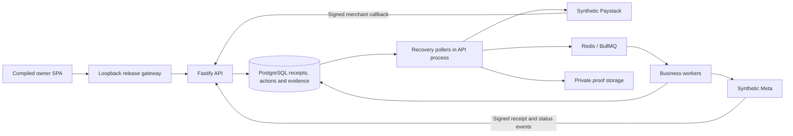

# Batch 1 execution contracts and recovery

## Topology



Business-facing permissions follow the existing [delivery and staff role contract](delivery-authorization.md). Provider I/O never supplies authorization for an order, reservation or manual credit.

## Verification

The synthetic API and web build use services on IPv4 loopback. Start disposable PostgreSQL and Redis on dedicated ports. Use a database named `flowdesk_g1_*` and a non-default Redis port. Set `DATABASE_URL`, `DIRECT_URL` and `REDIS_URL`; the first two must identify the same database in the synthetic smoke run. Run the following from a clean checkout.

```sh
pnpm install --frozen-lockfile
pnpm db:generate
pnpm db:migrate
pnpm build
pnpm typecheck
pnpm lint
pnpm test
pnpm smoke:fixture
```

The runner starts compiled Fastify on IPv4 loopback with a synthetic child environment and waits for JSON health. It routes the suite through the local gateway with the built SPA. It checks that a deep link returns the SPA, that an unknown API route returns JSON 404 and that the API finishes its graceful shutdown handler. The Meta transport rejects a synthetic send with code 190 and blocks external requests. The script selects rule-based order intake via the owner settings endpoint. It checks the invite acceptance URL and signs in the invited employee. Trial usage reflects the Business entitlement while the stored subscription is Starter. Unlimited product limit serializes to JSON null. The explicit `SMOKE_ENV_FILE` accepts LF and CRLF, with exported environment values taking precedence. Missing or invalid signing configuration fails before any test request.

## Inbound commercial effects

- The rule engine can create an order for an explicit purchase while AI mode is off. The transaction locks the same tenant and customer as the inbound row, guards current business policy and reads the tenant catalogue under locks. The unique order source ID and atomic message association make retry safe. The assistant shares the order boundary and revalidates grounding and autonomy. A resolved or expired pending order cannot convert again.
- A classifier dispatch can be replayed if its job disappears before durable processing evidence. PostgreSQL keeps a bounded check schedule after queue handoff. A processed message with an unfinished rule order may replay that same effect. Repeated failure exhausts to a review state. The pre-Batch G1-06 migration retains its existing rows without backfilling unproven processing work.
- Redis conversation mutex acquisition failure stops the assistant turn for review. Release requires the original token. A lease expiry does not bypass PostgreSQL commercial identity or booking constraints.
- The booking source ID is unique and appointment overlap is enforced in PostgreSQL. The transaction verifies the tenant, customer, signed message content, current authorization and service. An exact live booking is returned on replay.
- A manual `POST /api/v1/payments` may carry an opaque `Idempotency-Key` of 16–128 characters. An exact retry by the same actor returns the prior ledger entry. Divergent content or actor under the same tenant key conflicts. Requests without a key retain the existing manual-entry contract.
- Paystack receipt admission uses one parameterized statement to resolve the merchant reference and insert the signed event identity. Exact concurrent duplicates wait on the unique index winner. An exhausted connection pool returns a retryable 503, with the Prisma code logged and no successful acknowledgment. Re-deliver the original signed bytes and inspect the single resulting settlement.

## Messaging and review

An approved draft and its send intent are committed together. Other send producers persist intent before scheduling. The row distinguishes authorization, queued, sending, provider accepted, delivered, read, failed, retry pending and review required. The conversation view distinguishes these states. Existing inbound draft status remains the review surface.

The worker revalidates the business, phone connection, customer, recipient, message and order scope, staff capability and service window before making a provider request. It checks for an owner-app reply before sending automation. A provider request already underway cannot be revoked. A definite provider throttle may retry. A timeout, uncertain HTTP result, crash during the provider attempt or local acknowledgment failure remains reviewable. Never clear that state by scheduling another provider send.

The signed webhook commits normalized sent, delivered, read and failed receipts before acknowledgment. A callback cannot prove delivery for a different phone or recipient. Matching provider IDs are reconciled even if their callback arrived before the local send response was committed. A signed callback with the opaque send ID can reconcile an interrupted send with no local provider ID. If the callback is missing, lacks correlation or is contradictory, leave the send in review and verify its status with the provider before an operator sends another message. Meta documents the API request and webhook mechanisms. [Meta platform overview](https://developers.facebook.com/documentation/business-messaging/whatsapp/overview) · [Meta webhook components](https://developers.facebook.com/docs/whatsapp/cloud-api/webhooks/components/)

## Fulfillment

Use the G1-02 role and assignment contract. Dispatch and completion lock the order and staff assignment. Stock moves with applicable order transitions. History, actor audit and the status notification task are written in the same database transaction. An exact repeat of dispatch or completion returns the current result. A separate worker resumes undelivered handoff by order ID and status, and writes a deterministic outbound send.

A proof upload stages an object under a tenant and order key. A prospective cleanup task commits before PUT. The proof transaction rechecks assignment and marks the linked object live, and schedules cleanup for any superseded key. The cleanup worker checks that no shipment references the key. A failed cleanup keeps its safe reason and backoff. An uncertain upload is recorded as `PROOF_UPLOAD_UNCERTAIN`. A blocked notification records `SUPPRESSED` with the delivery policy reason. A `DONE` notification task marks durable handoff, with provider evidence stored separately. For a stopped proof write, check the shipment row before retrying cleanup. Never manually delete a referenced proof object.

## Local release and restoration

The local gateway serves built web assets and SPA deep links while proxying the API and health paths to the running API. Start it with `API_URL=http://127.0.0.1:<port> pnpm release:local` or set the equivalent environment variable in PowerShell. The two-process local topology keeps browser requests same-origin. The Vercel SPA fallback excludes API paths so a missing hosting proxy cannot return a false successful HTML response. The public hosting proxy configuration and provider accounts require separate staging validation.

The API checks PostgreSQL, Redis and Batch 1 schema sentinels before starting workers and accepting requests. The release runs `pnpm db:migrate` and `pnpm exec prisma migrate status --schema prisma/schema.prisma` before starting the API. Postgres needs both pool and direct migration URLs. Runtime requires the existing JWT and encryption settings. The local release should set `HOST=127.0.0.1` on Fastify. Meta, storage, billing and AI credentials stay in secret configuration. Do not copy a production environment file into a fixture.

For a disposable upgrade, deploy the previous schema to an empty second database and load synthetic historical receipts and settlements. Run `pg_dump --format=custom` for the verified starting state. Apply this branch's additive migration, verify receipt identities and effects, then restore with `pg_restore --exit-on-error` into a separate empty database. Keep any backup and fixture credentials out of Git. Rollback stops matching workers before changing code. Preserve the additive database schema and outbound, settlement, fulfillment and receipt evidence. Resume with a compatible version rather than dropping new data. All rehearsal databases must be disposable.

For a release stop, remove the API from ingress and stop its workers before promoting a binary. Let the shutdown handler drain active workers. Inspect durable states and preserve the pre-release backup. A code-only rollback is safe to rehearse with ingress paused. The previous binary has no outbound-send or fulfillment task poller. Drain or explicitly quarantine remaining legacy outbound jobs before taking new traffic under Batch 1. Keep the Batch 1 tables in place during a code rollback and reconcile outstanding evidence before reopening. To roll forward, verify the applied migration history, start the Batch 1 binary, check JSON readiness, and confirm recovery of waiting work. A restored copy remains isolated until it is reconciled with committed writes after the backup.
