# G1 final stabilization

**Recommendation — PASS for G1 local acceptance.** The final application passed the clean release checks, full disposable regression and fresh critical repeat. Hosted and live-provider assurance remain separate.

## Source and checkpoints

The stabilization branch is `codex/g1-final-stabilization`, starting from clean Batch 1 head `aaff391560a30863ce27871e0f2c67ee9b0351d6`, verified against the remote branch. Its ancestry includes the Batch 1 runtime snapshot `7e4c434d1e5cb04f90833cbeb438a9c5f9afb614` and diagnostic fixture `e7a0d941cc9161b3e14c6d8f2a09969210a52cfa`. Between those snapshots the Paystack integration test changed and the subsequent commit added engineering records. The application runtime was identical in both. Batch 1 evidence remains historical.

| Stabilization implementation | Scope |
| --- | --- |
| `2e04006` | Transacted reorder crossings, durable post-commit owner notifications, migration, runtime route gating. |
| `5d09784` | Dashboard payment identity, refresh and ambiguous-response contracts with browser-side tests. |
| `26d86ba` | Assistant phase diagnostics and recovery, classifier worker lifecycle, active retail worker test, and PostgreSQL regressions. |
| `2b6fc0906c8be4096b92b6558f3c5398c43588de` | Isolated Paystack queue fixtures, actual Redis process restart test, and schema startup prerequisite. |
| `dac462e2f9bf4bf550374ba212657ee69b558495` | Known failed BullMQ attempts enter review immediately and injected dependency errors stay scoped to their tests. |
| `b61d394ac40eb0d1e13d60c9cf15b5f3a177822a` | Retail verification runs production fulfillment recovery and durable outbound reconciliation timers. Application source is identical to `dac462e`. |
| `406bcb05d7d5865644a11eab855aca19dadd95fd` | The eviction test drains the bounded global backlog before asserting its specific receipt. Application source is identical to `dac462e`. |
| `63ad4903aa3dece1da4f8ae7283f39bbbd312056` | Stock suppression waits through bounded recovery passes. The retry-limit fixture establishes historical phone ownership independent of clock skew. Application source is identical to `dac462e`. |
| `897c4fb`, `f5282c401e0f991b2514d27e1b09e09746364857` | The browser preserves an earlier ambiguous submission even when a later replay is rejected. Only web files changed after `63ad490`. |
| `f12af338b0e7a801de9a7848286ce367d383de61` | Outbound work waits for the scheduler's exact row lock. Added a controlled PostgreSQL regression. |
| `855f11b0f18142725fdc88a0d44b477dcd3076e4` | Establishes historical ownership explicitly for test phones, preserving true reassignment boundaries. |
| `84c92ac0c5c70bad0b6c9d28e7ea15688ef33d4d` | Leaves the source policy claim available to the conversation mutex winner. Final application and test source. |

## Retail investigation

The Batch 1 failure persisted a classified inquiry with `REVIEW`, `effect_unavailable`, no recorded model result, and no grounded quote intent. Its saved evidence cannot identify the triggering exception. The older test changed the Prisma pool checkout timeout and mixed test ownership of import-started queue consumers. It also called the classifier handler inline, so that run did not establish the worker path.

The current runtime takes fewer simultaneous catalogue/context connections and retries one safe evidence read when Prisma reports a recognized transient code. Persistent read failure preserves the message in review and records the runtime phase and safe code. A later effect may already have committed and is handled separately. Provider and business policy failures remain bounded by the existing policy and commercial constraints. Explicit worker startup removes accidental cross-suite classification. The Paystack fixture uses a separate logical Redis database and closes all worker and producer connections.

For an interrupted turn, correlate the receipt and inbound message IDs with `aiPolicy.state`, `aiPolicy.failure`, and any linked order, booking, or send. A committed send takes precedence over a later transport error. When there is an ambiguous provider attempt, use the signed status evidence or operator review to resolve it. An absence of provider evidence does not authorize another send.

The deterministic assistant regression injects a pool acquisition `P2024` at the pending-order read. One injected failure converges to a grounded handoff and one model call. Persistent failure sends the turn to review with the phase and code and generates neither another model request nor a quote. The concurrent Paystack tests exercise real PostgreSQL admission under normal load and explicit saturation. The failed admission returns 503, records no receipt for that request, and exact replay after pool capacity returns yields one settlement. The historical intermittent errors retain their documented uncertainty.

## Execution boundaries

```mermaid
flowchart LR
    W["Signed WhatsApp event"] --> R["Fastify and PostgreSQL receipt"]
    R --> D["Receipt dispatcher"]
    D --> B["Redis / BullMQ classifier"]
    B --> A["Policy, model and authoritative facts"]
    A --> Q["Durable quote intent"]
    A --> O["Source-bound order"]
    O --> C["Hosted checkout"]
    C --> P["Signed Paystack receipt and verification"]
    P --> L["One PostgreSQL ledger settlement"]
    L --> F["Authorized dispatch and completion"]
    F --> N["Durable fulfillment notification"]
    Q --> S["Outbound BullMQ worker"]
    N --> S
    S --> M["Synthetic Meta acceptance"]
    M --> E["Signed delivered status and reconciliation"]
```



The retail integration test runs three independently seeded tenants through Fastify routes, durable admission, the production receipt dispatcher entry point, real BullMQ classifier and outbound worker loops, fulfillment and outbound recovery timers, and PostgreSQL. It uses three synthetic product quotations, an explicit rule-based purchase after the quote, hosted checkout, a repeated authenticated callback, owner dispatch, repeated delivery completion and a repeated signed delivery status. The test drives the production Paystack settlement pass directly to control the timing. Separate tests target that pass across real process death, tenant collisions, and database and Redis failures. Provider transports use synthetic responses or an IPv4 loopback server.

## Reproduction

Use the [Batch 1 reproduction commands](batch-1-report.md#reproduction) on the exact stabilization source. On Windows use a short archive path for pnpm dependencies. The seeded upgrade should contain the prior G1-06 fixtures before the four Batch 1 and stabilization migrations run. To test the actual Redis process restart, set `G1_TEST_REDIS_BINARY` to an installed local `redis-server` or Memurai executable. The test allocates its own IPv4 loopback port and volatile Redis configuration and kills only its own child.

```sh
pnpm install --frozen-lockfile
pnpm db:generate
pnpm build
pnpm typecheck
pnpm lint
pnpm test
pnpm db:migrate
pnpm exec prisma migrate status --schema prisma/schema.prisma
pnpm smoke:fixture
pnpm --filter @flowdesk/api exec vitest run tests/assistant-policy.integration.test.ts --maxWorkers=1 --minWorkers=1 --testTimeout=30000 --reporter=verbose
pnpm --filter @flowdesk/api exec vitest run tests/paystack-settlement.integration.test.ts tests/batch-reliability.integration.test.ts tests/delivery-authorization.integration.test.ts tests/whatsapp-text-receipts.integration.test.ts --maxWorkers=1 --minWorkers=1 --testTimeout=30000 --reporter=verbose
```

The full regression additionally runs the 28-file Batch 1 command linked above after the separate assistant command. The fresh repeat uses the four-file command with newly initialized PostgreSQL and Redis. For the local rollback, migrate the archive of `aaff391`, run the current compiled API against that schema to confirm it refuses startup, apply the final migration, seed the synthetic evidence and switch binaries with ingress quiesced. Back up with `pg_dump --format=custom`, restore into a separate empty database with `pg_restore --exit-on-error`, and query the restored evidence.

The runtime requires the `20261114210000_durable_low_stock` migration before accepting traffic. A G1-06 binary rollback can preserve additive state. If rolling back to an intermediate Batch 1 binary with a fulfillment worker, quiesce and isolate that worker to preserve pending `OWNER_LOW_STOCK` tasks. Resume them after roll-forward.

## Verification register

The candidate run before the final fixture isolation and startup guard passed 65 targeted API tests. It included three full-worker retail journeys. The initial web test command passed two tests. These runs explain the development checkpoint. Final source results follow separately.

At `2b6fc09`, the four-suite fresh-fixture repeat passed 83 cases. The full regression stopped after 18 passed and 12 failed in the assistant suite. Querying the stopped fixture showed 30 generic `pending_order` failures after a Prisma delegate spy was restored. The fault now sits at the module boundary, delegates healthy calls to the real repository and scripts only finite failed calls. The clean default suite also exposed two failures. An existing classifier retry expected immediate review after a known failed attempt. The payment-notification unit test left its owner notification dependency connected to Prisma. The fix marks failed retries for review and explicitly mocks that unit-test dependency. A focused rerun of both affected default suites passed 12 tests on `dac462e`.

On `dac462e`, the historical and empty migrations completed with exit 0 and `prisma migrate status` confirmed 33 migrations. The historical backup and restore returned exit 0. In the binary rehearsal, the prior 32-migration schema caused the current API to refuse startup with exit 1. Applying the owner alert migration, starting and gracefully shutting down the current API, switching to the G1-06 binary, and restarting the current API all passed. The post-upgrade backup and restore preserved the financial receipt, its linked settlement and ledger entry, the outbound review state, and a pending owner stock task. Each binary switch and data check returned exit 0.

The `dac462e` focused repeat passed 83 cases. A parallel full run passed 30 assistant cases and 377 remaining cases, with two failures in the second command. One was a different retail failure from Batch 1. SQL inspection of the live disposable fixture showed `HANDED_OFF` for the assistant and a grounded outbound row in `QUEUED` with zero provider attempts. The test had not started the production recovery timers, so it could not observe the normal replay path. The updated test starts those timers and asserts committed provider acceptance, fulfillment notification and delivered state. The other failure assumed that two competing bounded recovery passes must find a designated evicted receipt despite a global backlog. The updated test drains older work under the same bound and still checks a single successful claim and the exact recreated job.

The clean short-path archive of `dac462e` ran a frozen install and fresh build. Install, Prisma generation, build, typecheck, lint, default tests, migrations and synthetic smoke each returned exit 0. The API ran 991 tests and skipped 164 cases that require disposable fixtures. The web ran two tests. All 53 smoke assertions passed, including the compiled gateway, HTML deep link, JSON API 404 and graceful shutdown. Secret-format checks found zero matches in the committed patch and the repository tracks no real application dotenv file. Fixture subprocesses used IPv4 loopback and synthetic credentials.

The production-poller fixture completed three retail journeys in the next full run and three in its focused repeat. The full run passed 30 assistant and 378 regression cases and failed one direct proof-recovery pass with a PostgreSQL connection error. The simultaneous focused repeat passed 81 and failed two fixture assertions. Its stock task was still pending after one global pass. Its phone retry-limit case admitted an event with unverified ownership before it could exercise retries. The test now explicitly creates historical ownership and asserts the pinned receipt, and the stock test waits for bounded worker passes. A standalone G1-01 run at `406bcb0` passed all 18 cases, with an actual Redis restart. The final campaign runs the full and focused sets serially on fresh fixtures.

The final API regression at `63ad490` returned exit 0 in both commands, with 30 assistant cases and 379 other cases. No case skipped. It included three worker-backed retail journeys, real Redis process restart, Paystack capacity fault and replay, booking competition, concurrent stock adjustment recovery and tenant authorization. Explicit adjustments and sales deductions share the low-stock task write. The final web-only commits make no changes to the API, database migrations or integration tests used by those commands.

The fresh repeat after that pass exposed a confirmed outbound race. The stuck fulfillment send remained `QUEUED` with zero attempts despite repeated scheduling. The scheduler had published the BullMQ job and was updating the durable row. The worker used `FOR UPDATE SKIP LOCKED` for that specific job, so it could skip the row and finish the queue job before any provider attempt. This could repeat at the next scheduling pass. A real PostgreSQL test held that row lock and demonstrated the old worker returned without waiting, exit 1. The regression after the fix passed, exit 0. PostgreSQL recorded the lock wait, the worker claimed one attempt after release and a replay made no additional provider call. The same repeat also exposed an unpinned phone during Redis outage fault injection. The fixture now supplies an explicitly established first binding. Real reassignment and unbound receipt tests retain their separate paths.

The next assistant run ended with 29 passing cases and a duplicate-purchase case that created zero orders. The failed fixture recorded one `REVIEW/conversation_lock_unavailable` policy for the contended source. The worker holding the mutex was still preparing its claim when the losing call persisted a policy into the empty source slot. The losing call now flags the message and logs its phase without claiming that policy slot. A controlled regression holds the real Redis mutex before the winning SQL claim and confirms that the losing call cannot block the single purchase.

### Final source results

All final commands used source `84c92ac0c5c70bad0b6c9d28e7ea15688ef33d4d`. The short-path archive ran a clean frozen install and a cold build. `pnpm install --frozen-lockfile`, `pnpm db:generate`, `pnpm build`, `pnpm typecheck`, `pnpm lint`, `pnpm test`, `pnpm db:migrate` and `pnpm smoke:fixture` returned exit 0. The default suite passed 991 API and three web tests, with 166 fixture-dependent API skips. All 53 smoke assertions passed.

The final full disposable regression returned exit 0 for 31 assistant cases and 380 other cases. It included the conversation mutex and PostgreSQL outbound row-lock regressions, three complete retail journeys and a real Redis process restart. The empty and historical migrations and schema status checks passed. The final incompatible-startup probe and the rollback, roll-forward, dump and restore rehearsal also passed with the expected startup refusal on the prior schema.

The final four-suite repeat used newly initialized PostgreSQL and Redis fixtures and the same source. It returned exit 0 with 84 passing tests and zero failures or skips. It exercised three more full-worker retail journeys, bringing the final campaign to six. The forced Paystack 503 withheld acknowledgment and settled once after replay. The actual Redis restart, classifier eviction, provider ambiguity, outbound process kill, stock replay, and proof reassignment cases passed. Both fixture runs stopped their database and queue processes after verification.

| Gate | Final source evidence |
| --- | --- |
| G1-00 clean verification | Clean install, Prisma, build, typecheck, lint, default tests and compiled gateway smoke passed. |
| G1-01 text ingress | Verified signed admission, database refusal, queue interruption, eviction recovery, bounded scans, interrupted classification review and real Redis restart. |
| G1-02 assignment and proof | Verified rider and owner scope, cross-tenant rejection, race handling and private proof access. |
| G1-03 merchant settlement | Verified normal concurrent admission and genuine pool saturation, exact replay, financial uniqueness and process recovery on synthetic providers. |
| G1-04 financial relationships | Verified ledger foreign keys, stale or wrong actor/tenant, keyed manual UI submissions and stable replay. |
| G1-05 assistant authority | Verified G1-05 policies, rerouting for unsupported facts and deterministic read capacity faults. |
| G1-06 media and echo | Verified signed mixed batches, synthetic object storage failures, pinned ownership and worker restart. |
| G1-07 commercial idempotency | Verified order source uniqueness, booking replay and capacity, one concurrent ledger credit, and durable review for uncertain effects. |
| G1-08 outbound evidence | Verified retries, duplicate callbacks, ambiguity review, evicted jobs, Redis failure and killed send workers. |
| G1-09 fulfillment and stock | Verified dispatch transactions, completion replay, proof cleanup and durable stock crossings with preference checks. |
| G1-10 release and migration | Verified empty and historical schema, incompatible startup, graceful restart and binary rollback, backup and restore. |

## External assurance and recovery limits

Meta coexistence, provider status correlation, approved templates, Paystack merchant verification, live model accuracy, managed Redis, private object storage and hosted routing require authorized provider and hosting assurance. A browser's pending payment identity is scoped to its current tab and actor. The order drawer needs storage access to safely create a new manual request. Booking deposits and reminders depend on later operator work. Synthetic evidence establishes local behavior. An assistant effect whose commit cannot be proved stays visible in review. Provider ambiguity requires matching authenticated status evidence or human reconciliation.
